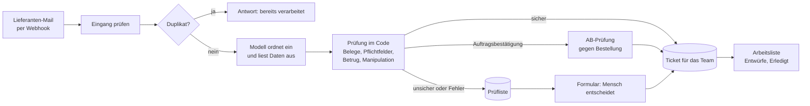

# Architektur und Entscheidungen

**Stand:** 11.11.2026 · **Art des Dokuments:** nachträglich zusammengefasst. Die Entscheidungen wurden unterwegs getroffen. Das Datum nennt, wann sie fielen oder in Kraft traten.

## Überblick

Alles läuft in Docker auf einem Rechner: n8n (Workflows), PostgreSQL (Daten) und Ollama mit dem Modell qwen2.5:7b (auf dem Rechner selbst).

## Bausteine

| Baustein | Aufgabe |
|---|---|
| Workflow 01 Mail-Triage | Eingang, Duplikatprüfung, Modellaufruf, Prüfung im Code, AB-Prüfung, Ticket oder Prüfliste |
| Workflow 02 Arbeitsliste und Review | Weboberfläche, Erledigt-Endpunkt, Review-Formular |
| Workflow 03 Fehlerbehandlung | schreibt unerwartete Fehler in ein Protokoll |
| Workflow 04 Antwortentwurf | Entwurf aus Vorlagen mit gewähltem Ton |
| PostgreSQL | Daten (siehe unten) |
| Ollama mit qwen2.5:7b | Einordnung und Auslesen, Antwort als JSON nach festem Schema |

## Datenmodell (Datenbank `triage`)

| Tabelle | Inhalt |
|---|---|
| `team_routing` | Kategorie zu Team und Postfach |
| `einstellungen` | Schwellen der AB-Prüfung (Liefertreue, Blindbestätigung) |
| `lieferanten`, `bestellungen` | Stammdaten, wie sie im ERP stünden (Beispieldaten) |
| `tickets` | eingeordnete Mails mit ausgelesenen Daten, Warnungen, AB-Prüfung, Status, Inhalts-Hash |
| `entwuerfe` | Antwortentwürfe je Ticket |
| `review_queue` | unsichere Fälle mit Mail, Gründen und Modellvorschlag |
| `fehler_log` | unerwartete Fehler |
| `app_geheimnis` | Geheimnis für das Token des Erledigt-Knopfs |

## Schnittstellen

| Adresse | Zweck | Schutz |
|---|---|---|
| `POST /webhook/lieferanten-mail` | Mail annehmen | Token im Header |
| `GET /webhook/arbeitsliste` | Arbeitsliste | Login (Basic Auth) |
| `POST /webhook/aufgabe` | Aufgabe erledigen | Login und Token je Aufgabe |
| `/form/entwurf`, `/form/review` | Formulare | Login |

## Entscheidungen

| ID | Datum | Entscheidung | Grund | Alternative | Folge |
|---|---|---|---|---|---|
| E-01 | 30.10.2026 | n8n als Plattform, Python nur für Hilfsskripte | Fachbereich sieht den Ablauf im Editor, Wiederholung, Fehler-Workflow und Formulare gibt es fertig | reines Python-Programm | Logik steckt teils in Code-Knoten |
| E-02 | 30.10.2026 | Lokales Modell (qwen2.5:7b über Ollama) statt Cloud | Mails enthalten Preise und Konditionen, Datenschutz | Cloud-Modell über eine Schnittstelle | Mehr Fehler als bei großen Modellen, deshalb E-03 |
| E-03 | 30.10.2026 | Prüfen statt vertrauen: Belegprüfung im Code, Antwort als JSON nach Schema | Das Modell erfindet gelegentlich Werte, seine Sicherheitsangabe ist wertlos | Modell-Konfidenz als Schwelle | Mehr Code, dafür überprüfbar |
| E-04 | 30.10.2026 | Betrugsschutz als feste Regel, unabhängig vom Modell | Bankdaten-Änderung ist eine typische Masche | Entscheidung dem Modell überlassen | Regel ist umgehbar, daher zusätzliche Schichten |
| E-05 | 30.10.2026 | Zuständigkeiten in einer Tabelle | Fachbereich ändert ohne Deployment | feste Zuordnung im Workflow | |
| E-06 | 30./31.10.2026 | Antwortentwürfe aus Vorlagen, nicht vom Modell | Das 7B-Modell hielt sich nicht an Regeln (zweite Anrede, Floskeln, Zusagen) | Entwurf vom Modell | Vorlagen sind verlässlich, aber starr |
| E-07 | 10.11.2026 | Rückbau auf den Kern: Freigaben, Ränge, Themes gestrichen | Das Tool soll Arbeit abnehmen, nicht Verfahren hinzufügen | Ausbau um Genehmigungen | Stand vom 31.10. wiederhergestellt |
| E-08 | 11.11.2026 | Elf statt 22 Kategorien, interne Mails ohne eigene Kategorie | Jede Kategorie kostet Genauigkeit, nur sinnvoll wenn die Mail woanders hingeht | alle Typen aus der Praxisliste | Interne Mails nur zur Hälfte richtig im Sammelbecken |
| E-09 | 11.11.2026 | Feste Regel statt Prompt-Anpassung für „AB mit Preisänderung" | Der Prompt-Zusatz verschlechterte das Ergebnis (97 auf 94 %) | Prompt weiter anpassen | Regel nur für den eindeutigen Fall |
| E-10 | 11.11.2026 | Duplikate zusätzlich über Inhalts-Hash (30 Tage) | Dieselbe Mail unter neuer Message-ID erzeugte ein zweites Ticket | nur Message-ID | neue Spalte `inhalts_hash` |
| E-11 | 11.11.2026 | Erledigt-Knopf mit Token je Aufgabe statt Herkunftsprüfung | n8n liefert die Seite in einer Sandbox aus, die Herkunft ist `null`, die Prüfung hätte jeden Klick abgelehnt | Herkunft `null` zulassen | Tabelle `app_geheimnis` |
| E-12 | 11.11.2026 | Währung der AB wird gegen die Bestellung geprüft | Fehlende Geschäftsregel, im Test wurde eine EUR-AB statt CHF durchgewunken | nur dokumentieren | Regel nur bei Währung im Mailtext |
| E-13 | 11.11.2026 | Testsätze mit vorab festgelegten Lösungen, nach dem Lauf nicht nachbessern | Ohne das Overfitting (100 % auf eigenen Mails, 78 % auf fremden) | an den Testmails weiter anpassen | Sätze gelten nach Korrekturregeln nicht mehr als unabhängig |
| E-14 | 11.11.2026 | Gemeinsamer Login vorerst beibehalten | Aufwand, kein Pilot in Sicht | persönliche Konten | **bekannte Schuld**, siehe Risiken |
| E-15 | 11.11.2026 | Weiterleitung nach Formularen mit voller Adresse (`http://localhost:5678`) | n8n setzt bei relativer Adresse ein „https://" davor | relative Adresse | bei anderem Rechner anpassen |
